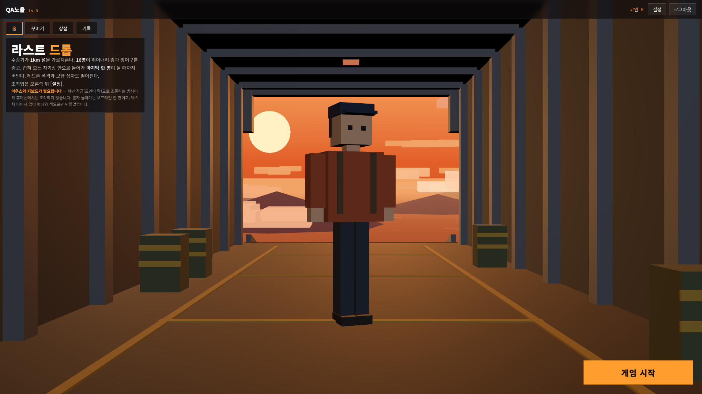
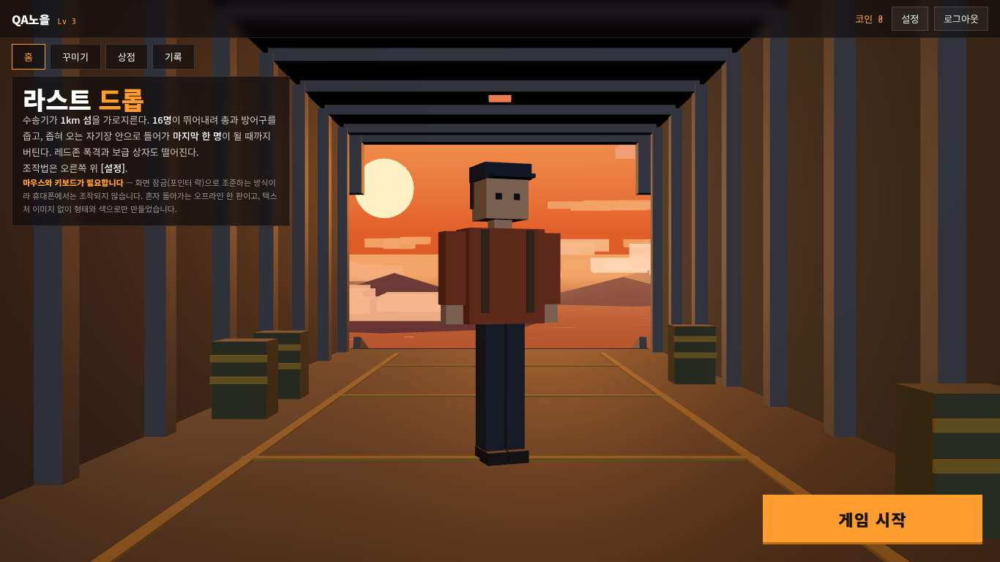
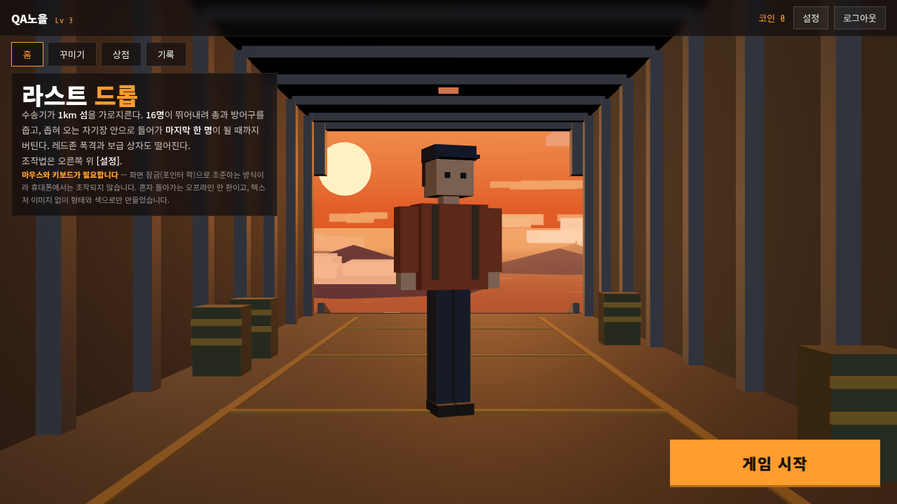
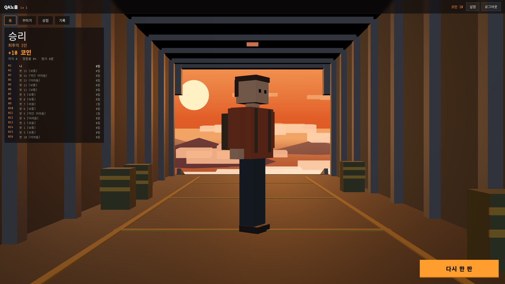
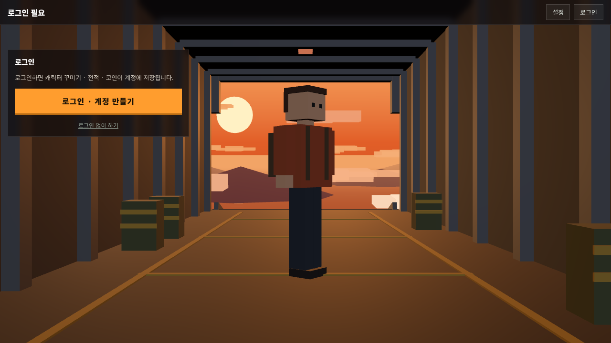
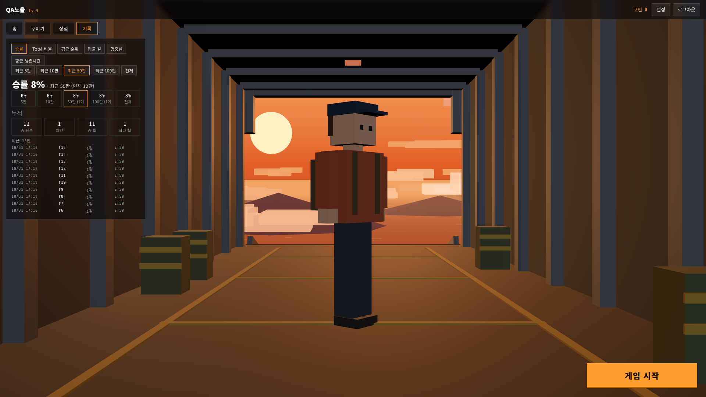

# 30 - 홈 화면 배경·구도 (노을 속 수송기 화물칸) + [기록] 화면 구성 (29-b)

## 무엇을 했나
라스트 드롭 홈 화면을 **전체 화면 3D 장면**(노을 속을 나는 수송기 화물칸, 열린 램프 너머 하늘·구름·섬·바다)으로 바꾸고,
UI 를 위쪽(상단 바 + 탭) · 왼쪽 반투명 패널 · 오른쪽 아래 큰 [게임 시작] 으로 다시 짰다. 캐릭터 전신이 화면 비율에 맞춰 늘 다 보인다.
같이 받은 요청으로 **[기록] 화면을 항목 버튼 × 판 수 버튼** 구성으로 바꾸고, 서버 판 기록을 **최근 100판 상세 + 전체 누적 합계**로 바꿨다.

> **30 검토 반영 후 운영 배포 완료** (정현 승인) — 아래 5절 "검토 수정 · 배포 · 실서버 확인".
> 처음 커밋(a6a60b9) 때는 배포가 자동 모드 권한에서 거부돼 반영되지 않았었다.

## 변경 파일 목록
| 파일 | 내용 |
|---|---|
| `lastdrop/index.html` | 홈 화면 마크업(3D 캔버스 · 상단 바 · 탭 · 왼쪽 패널 · [게임 시작]) · 스타일 · 기록 화면 스타일 |
| `lastdrop/game.js` | 홈 장면(`buildHome` · `frameHome` · `renderHome`), 탭·패널, 설정(소리·감도), 레벨, 기록 계산 |
| `server/game_accounts.py` | `ld_totals`(누적), 판 상세는 계정당 최근 100판만, `/stats` 가 최근 100판 원자료 + 누적 |
| `docs/img/30-*.png` | 스크린샷 |

## 1. 장면

| 지시 | 구현 (형태·색만, 텍스처 없음) |
|---|---|
| 노을 하늘 | 정점 색 구: 아래 진한 주황 → 위 연한 노랑·살구(7단 그라데이션), 수평선 근처 해 |
| 낮은 구름 몇 겹 | 납작한 상자 묶음 26개(살구·분홍 4색), 대부분 수평선 아래 낮게 + 몇 개 수평선 위 먼 하늘 |
| 섬 실루엣 · 바다 반짝임 | 보라빛 낮은 원뿔 4개 · 주황 바다 면 + 반짝이는 조각 90개(깜빡임) |
| 구름이 흘러감 | 구름이 램프 너머로 계속 멀어지고 다시 나타남 (속도 9~18 m/s) |
| 화물칸 | 바닥·양벽·천장, 늑골 프레임(1.5m 간격), 문틀, 내려간 램프, 바닥 고정 띠, 낙하산 가방 4개 |
| 붉은 경고등 | 천장 3개 + 붉은 점광원, 은은하게 점멸 |
| 조명 | 열린 문 쪽 주황 역광(3.0) + 옆 역광(1.4) — 윤곽이 노을빛, 실내 보조광(0.95) + 반구광 |

- 문으로 보이는 각도는 수평선 기준 −4° ~ +8° 뿐이라, 바다·섬을 25m 아래에 두고 바깥 풍경을 3.4° 기울였다(기수를 든 채 나는 중 — 뒤로 보면 수평선이 위로).
- 홈·결과 화면이 덮은 동안엔 섬(게임) 장면은 그리지 않는다.

## 2. 캐릭터 구도
- 크기: 가장 큰 모습(왕관·마녀 모자 끝 2.35m)이 **'UI 아래 영역' 높이의 78%** 가 되게 카메라 거리를 정한다 — 모자를 바꿔도 확대·축소가 튀지 않는다.
- 위치: 지금 모습의 실제 키 가운데가 그 영역 **세로 가운데**, 가로는 화면 가운데. 창 크기가 바뀌면 매 프레임 다시 계산.
- 천천히 숨쉬기(세로 1.2%), 저절로 천천히 돌고 끌면 돌린다. 꾸미기를 바꾸면 바로 반영.

### 검증 — 캐릭터 경계 상자 8꼭짓점을 실제 카메라로 투영해 UI 요소 사각형과 비교 (헤드리스)

| 화면 | 탭 | 캐릭터 (x0, y0, x1, y1) | 키 | 화면 안 | UI 와 겹침 | 영역 세로 가운데와 차 |
|---|---|---|---|---|---|---|
| 1920×1080 | 홈 · 꾸미기 · 상점 · 기록 · 설정 | 800,264 ~ 1079,903 | 621~639px | ✅ | **없음** (5탭 모두) | 2~8px |
| 1366×768 | 〃 | 577,221 ~ 769,642 | 421~429px | ✅ | **없음** | 0~6px |
| 1280×720 | 〃 | 541,203 ~ 716,601 | 388~398px | ✅ | **없음** | 1~6px |

비교한 UI: 상단 바 · 탭 · 왼쪽 패널 · [게임 시작]. 가로 가운데와의 차 5~20px 는 돌아간 캐릭터의 가방 쪽으로 경계 상자가 치우친 만큼.





## 3. UI
- **상단 바**: 왼쪽 닉네임 · `Lv N` / 오른쪽 `코인 N` · [설정] · [로그아웃]. (가운데 "치킨 · 승률" 은 30 검토로 뺐다 — 승률은 [기록] 에서만)
- **탭**(상단 바 아래): [홈] [꾸미기] [상점] [기록]. 게스트는 [상점] [기록] 없음.
- **왼쪽 패널**(반투명 어두운 판, 내용 높이만큼 · 넘치면 스크롤): 홈 = 소개(판이 끝나면 결과 — 순위·+N 코인·순위표) · 꾸미기 · 상점 · 기록 · 설정 · 로그인 안내.
- **[게임 시작]**: 오른쪽 아래, 300×68.
- **레벨**: 레벨 체계가 없어 **판수 5판마다 1** 로 임시 계산 (정현 확인).
- **[설정]**: 소리 켜기/끄기 · 마우스 감도(×0.4~2.5) — 이 브라우저에 저장 · 조작법.
- 로그인 전: 패널에 로그인 안내([로그인 · 계정 만들기] · "로그인 없이 하기"), 탭·[게임 시작] 숨김.




## 4. [기록] 화면 (29-b)
- 항목 버튼: [승률] [Top4 비율] [평균 순위] [평균 킬] [명중률] [평균 생존시간] — 하나 선택.
- 판 수 버튼: [최근 5판] [최근 10판] [최근 50판] [최근 100판] [전체] — 하나 선택.
- 크게 한 줄: 예 "평균 생존시간 1:48 · 최근 100판 (현재 7판)". 모자라면 있는 만큼으로 계산하고 "(현재 N판)", 0판이면 "—".
- 그 아래 다섯 기간 나란히(5 / 10 / 50 / 100 / 전체) — 추세.
- 선택은 브라우저에 저장(`localStorage`) — 다음 접속 때 그대로.
- 아래: 누적(총 판수 · 치킨 · 총 킬 · 최다 킬) · 최근 10판(날짜·순위·킬·생존시간).

### 서버
- `GET /game/api/lastdrop/stats` → **최근 100판 원자료 + 전체 누적 합계** 한 번에. 계산은 화면에서 (버튼마다 서버 왕복 없음).
- 저장: `ld_totals`(판수·치킨·Top4·순위 합·킬·최다 킬·발사·명중·생존 합) 를 판마다 갱신, `matches` 의 기록된 판은 **계정당 최근 100판만** 남긴다.
- 누적 테이블 전의 기록이 있는 계정은 처음 조회·기록 때 남은 판으로 누적을 만든다.
- 단위 시험: 105판 → 누적 105 · 상세 100 · 치킨 7(기대 7) · 생존 합 15960(기대 15960). 첫 판이 두 번 세어지던 순서 버그를 찾아 고쳤다(누적 준비를 이번 판 기록 '전' 으로).



### E2E (헤드리스, 로컬 서버)
기록된 7판(순위 1·16·3·7·1·12·2): 승률·최근 50판 "29% (현재 7판)", 비교 20%/29%/29%/29%/29% · 평균 순위·최근 5판 "5.0위"(손 계산 5.0) · 전체 6.0위(손 계산 6.0) ·
평균 생존시간·최근 100판 "1:48 · (현재 7판)" · 새로고침 뒤 선택 유지 · 누적 7 / 2 / 4 / 1. 코인·상점·꾸미기 E2E 도 새 UI 에서 전부 통과, 런타임 오류 0.

## 5. 검토 수정 · 배포 · 실서버 확인 (30 검토)

### 수정 내역
| 검토 항목 | 확인 · 조치 |
|---|---|
| 상단 바 가운데 "치킨 N회 · 승률 N%" | **삭제** — 상단 바는 왼쪽 닉네임·레벨 / 오른쪽 코인·설정·로그아웃만 (그리드 2칸) |
| 7판이 2분 안(16:53~16:55)에 기록됨 | **시험용 로컬 DB 직접 조작**이었다 — E2E 하네스가 로컬 시험 서버 DB(`acct/coin.db`)의 토큰 발급 시각을 200초 앞당겨(`backdate(200)`) 3분 검증을 통과시켰다. 서버 검증 버그 아님. **운영 DB 엔 들어가지 않았다** (배포 전 확인: 운영 계정은 `jung` 뿐, 판 기록은 모두 생존 224~256초의 실제 판) |
| "치킨 · 0킬 · 0:00" 행 | 같은 하네스가 판 시작 직후 봇을 모두 죽여 1등으로 끝낸 것 — 클라이언트가 실제 경과(1초 남짓)를 그대로 보냈다. 서버가 받아 준 건 구멍이라 **막았다: 4등 안인데 생존 시간 150초(3분 − 30초) 미만이면 거부** (`bad_survival`) |
| 시간당 13번째 | 전엔 "코인만 0, 전적은 기록" 이었다 → **기록·코인 모두 거부** (`hourly_cap`). 시간당 판수는 기록된 판 전부(코인 0 인 판 포함)로 센다 |

### 운영 DB 백업 · 배포 · 순단
- 백업: `valuetopic/data/backup-30-20261031-170606/game_accounts.db` (sqlite backup API, 권한 600 — 백업본에서 `jung` · 6판 확인) + 이전 `game_accounts.py` · 라스트 드롭 배포본.
- `deploy.sh` → Flask 재기동 — **순단 약 0.8초** (0.1초 폴링 120회 중 실패 7회). 시작 로그 등록 실패 0.
- 실서버 파일(허브 · 라스트 드롭 2개) md5 = 배포본, 운영 모듈 = 레포. DB 변경은 `ld_totals` 테이블 추가뿐 — `jung` 기록 그대로.

### 실서버 확인 (헤드리스 크롬 · https://www.valuetopic.com)
| 순서 | 결과 |
|---|---|
| /game 첫 화면 | 로그인 화면 (게임 목록 숨김) |
| 계정 만들기 → 로그아웃 → 로그인 | 게임 목록 + "로그인: QA노을" / 로그인 화면 / 다시 게임 목록 |
| 라스트 드롭 홈 | 노을 화물칸 · 전신 캐릭터 · 상단 바 `QA노을 Lv 1` / `코인 0 · 설정 · 로그아웃` — **승률 표시 없음** · 탭 홈·꾸미기·상점·기록 |
| [기록] (0판) | "승률 — · 최근 50판" |
| 한 판 (**실제 192초**, 봇에게 죽지 않게 시험 중 HP 만 채움) → 1등 | 결과 화면 **+10 코인** |
| 상점 캡 구매 → 장착 | "캡 샀다" · 코인 0 · "저장했다" |
| 로그아웃 → 재로그인 | 라스트 드롭으로 돌아오고 **캡 유지** |
| [기록] (12판) | "승률 8% · 최근 50판 (현재 12판)" · 누적 12 / 1 / 11 / 1 |
| 전신 · 겹침 | 1920×1080 · 1366×768 · 1280×720 모두 화면 안, UI 와 겹침 없음 |
| 런타임 오류 | 0 |

### 서버 검증 실측 (실서버, DB 조작 없이)
| 검증 | 결과 |
|---|---|
| 3분 미만 제출 — 토큰 발급 **160초 뒤** 2등·생존 155초 | 400 `too_short` "판이 너무 짧다 (3분 미만)" |
| 4등 안인데 생존이 짧다 — 발급 직후 4등·생존 20초 | 400 `bad_survival` |
| 같은 토큰 재사용 | 400 `token_reused` |
| 시간당 13번째 — 브라우저 1판 + API 11판(모두 200) 뒤 12번째 API 제출 | 400 `hourly_cap` "시간당 12판까지만 기록된다" |

### 기존 게임 회귀 (실서버)
| 게임 | 결과 |
|---|---|
| 허브 | 로그인 화면, 오류 0 |
| 땅따먹기 | 열림 · [봇과 플레이] 누르면 판 시작(게임 중 메뉴 표시), 오류 0 · 온라인 WS `wss://…/game/ws` 연결 OK |
| FPS | 열림(시작 화면 버튼 정상) · 콘솔 오류 1건 "[load] PeerJS 로드 실패" — **원래 있던 것**: FPS 가 2026-10-03 PeerJS 를 뺐는데 확인 줄(358행)만 남았다. 배포본 = FPS 레포 `f00ee6f`, 이번 작업과 무관 |
| 복셀 | 열림, 오류 0 |
| 배틀로얄 | 열림, 오류 0 |
| 라스트 드롭 (로그아웃 상태) | 로그인 안내, 오류 0 |

### 시험 데이터 정리
실서버 시험 계정 `vtqa30a` 와 그 세션 3 · 꾸미기 1 · 판 15 · 지갑 · 코인 기록 2 · 보유 1 · 거부 4 · 누적 1 · 가입 기록 1 을 **운영 DB 에서 지웠다**.
남은 계정 `jung` (판 7 · 지갑 10 — 정현의 실제 플레이, 손대지 않음).
스크린샷 속 [기록] 목록(17:10 · 2:50 줄들)은 이 시험 계정이 API 로 낸 판이다.

## 실행 명령
```
cd ~/land-grab-game && BR_SRC=~/battle-royale ./deploy.sh
~/.openclaw-mir/workspace/valuetopic/flask_server_off.sh && ~/.openclaw-mir/workspace/valuetopic/flask_server_on.sh
```
되돌리기: `cp valuetopic/data/backup-30-20261031-170606/game_accounts.py valuetopic/` · 게임 파일은 같은 폴더 배포본 · DB 는 그 폴더의 `game_accounts.db` (sqlite backup) → Flask 재기동.

## 문법 검사 결과
`node --check lastdrop/game.js` · `py_compile server/game_accounts.py` 통과.

## 새 커밋 해시
a6a60b9 — feat(30) 본 커밋

## 감독 확인 요청 사항 / 남은 이슈
1. **레벨 기준** — 지금은 판수 5판마다 1. 경험치·코인 기준 등 정할 것.
2. **[설정] 내용** — 지시서에 없어 소리·마우스 감도·조작법으로 했다.
3. 판 상세를 100판만 남기므로, 100판보다 오래된 판의 날짜별 기록은 사라지고 누적에만 남는다(지시대로).
4. FPS 의 "PeerJS 로드 실패" 콘솔 메시지(무해, 원래 있던 것) — FPS 레포에서 확인 줄을 지울지.
5. 실브라우저(정현): 노을 장면 분위기·성능(장면 두 개 중 홈 장면만 그린다), 드래그 회전.
