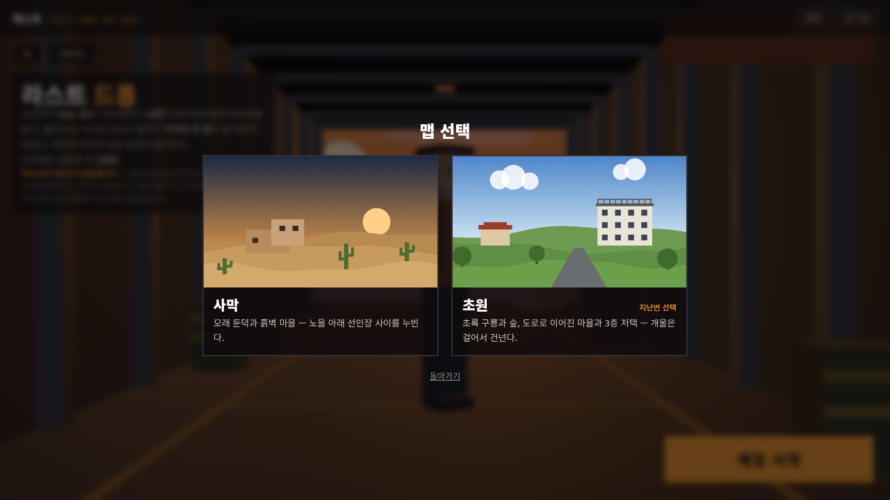
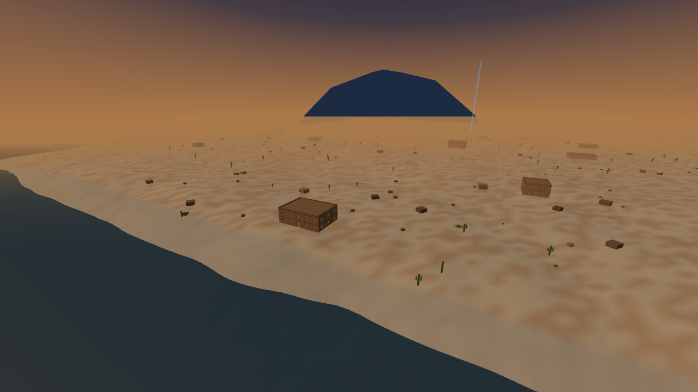
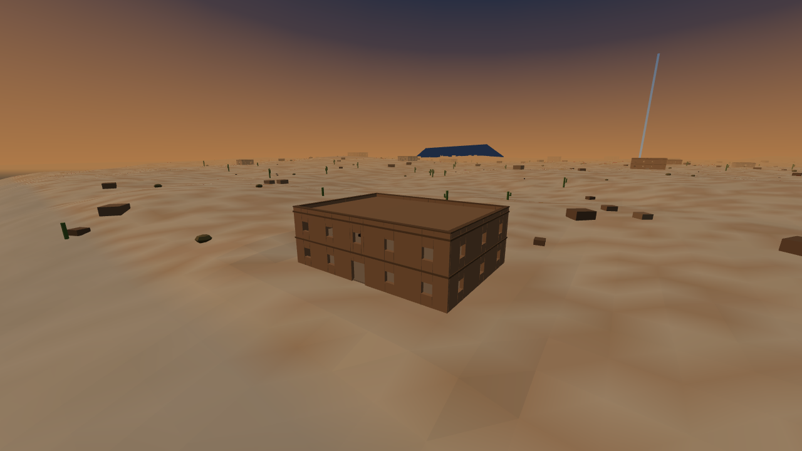
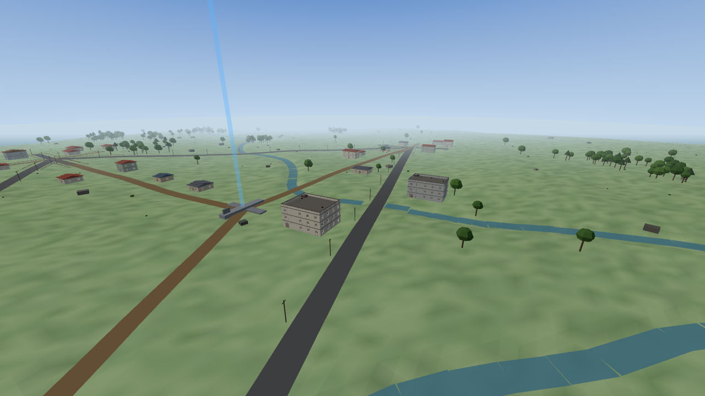
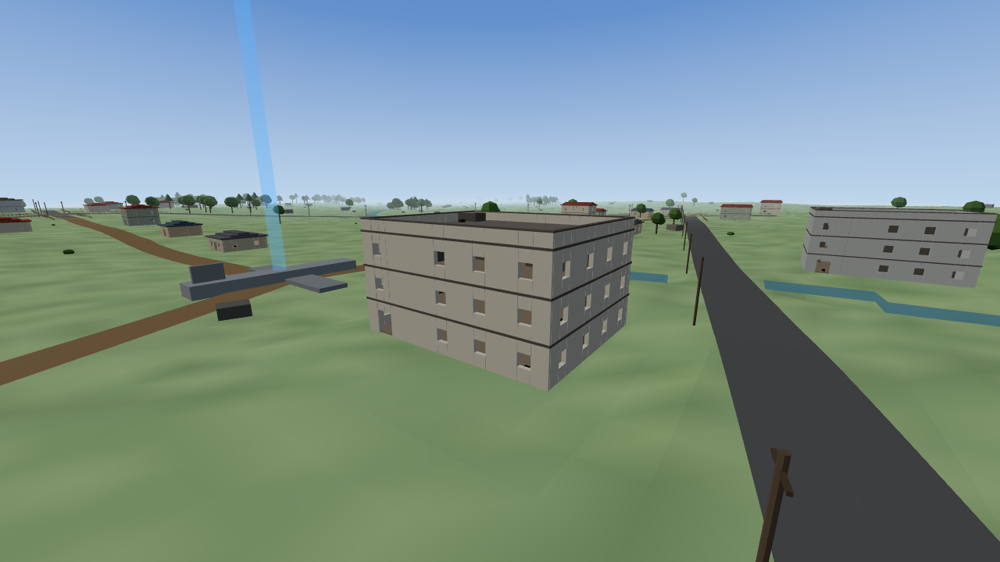
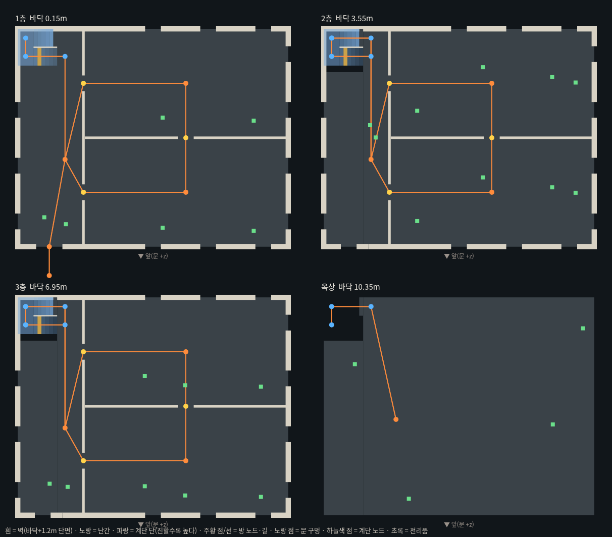
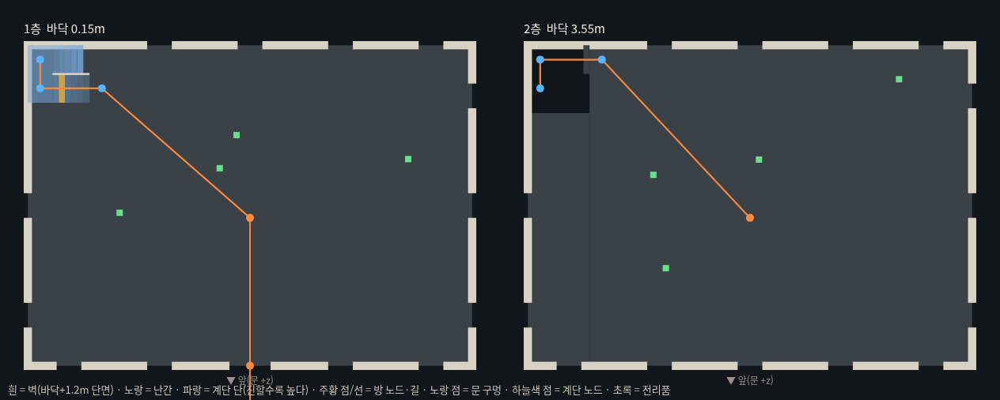

# lastdrop-07 레드존 지붕 + 맵 선택(사막/초원) + 3층 저택·계단·도로 + 봇 층 이동

카드 "[라스트 드롭 - 07 …]" 구현 기록. 코드는 `lastdrop/game.js`, `lastdrop/index.html` 만 바뀌었다 (서버 변경 없음).

## 1. 레드존 지붕 관통 버그

- 폭발 높이 = 그 자리 **맨 위 표면** `surfaceAt(x,z)` (지붕이 있으면 지붕 위).
- 피해 조건 (반경 11m 은 그대로):
  1. **덮임 검사** — 머리 위(발 + 1.75m×자세 + 0.1)에서 위로 60m `rayWorld` 가 무언가(지붕·윗층 바닥)에 닿으면 피해 0.
  2. **시야 검사** — 폭발점(+0.5m) → 몸통(발 + 1.0m) 광선이 벽에 막히면 피해 0.
- 실측 (같은 자리 위 1발 + 4m 둘레 8발 = 9발, 피해 합):

| 자리 | 사막 | 초원 |
|---|---|---|
| 저택/2층집 1·2·3층 모든 방 | 0 | 0 (9개 방 전부) |
| 단층집 안 | 0 | 0 |
| 옥상 · 지붕 위 | 552 | 552 |
| 문 밖 4m · 빈 들판 | 552 · 552 | 552 · 552 |

- 봇: 레드존 원(+6m) 안이면
  - 어려움 이상(tier ≥ 4) — 40m 안 건물 1층 방으로 숨는다(위가 막혀 덮임 검사를 통과하는 자리). 실측 3.1~3.2초에 덮인 자리 도착.
  - 그 아래 — 레드존 중심 반대쪽 원 밖 12m 로 뛴다. 실측 20초 뒤 중심에서 91m (원 반경 85m).

## 2. 맵 선택

- [게임 시작] → **맵 선택** 창(사막 · 초원 카드: 2D 캔버스 미리보기 + 한 줄 설명) → 카드를 누르면 그 맵으로 섬을 만들고 바로 수송기.
- 마지막 선택은 `localStorage.ld_map` — 다음에 열면 그 카드에 "지난번 선택", 포커스도 거기.
- [다시 한 판] 은 새로 고친 뒤 바로 맵 선택 창을 연다 (`sessionStorage.ld_again`).
- 기록·코인은 맵 구분 없이 합산 (서버 그대로). 기록 화면 맵 필터는 다음에.
- 섬은 이제 **맵을 고른 뒤에** 만든다 — 페이지 열 때는 홈 화면만 그린다 (`frame` 이 `MAP` 이 없으면 홈만).



## 3. 맵 정의 구조

```js
const MAPS = {
  desert: { name, desc, sky:{lo,hi}, fog:{c,near,far}, hemi:[하늘색,땅색,세기], sun:[색,세기], sea,
            base(x,z) /* 지형 높이 */, ground(x,z,h) /* 땅 색 [r,g,b] */ },
  meadow: { … },
};
let MAP, MAP_ID;              // boot(id) 에서 정한다
```

- 배치(건물·식생·도로)는 맵마다 `buildDesert()` / `buildMeadow()`, 둘 다 같은 **건물 생성기 `makeBuilding(o)`** 를 쓴다.
- 공통 로직(전투·파밍·자기장·레드존·지프·봇)은 그대로 하나.
- `boot(id)` 순서: `applyMapLook()`(하늘·안개·조명) → `buildHeightGrid()` → `buildProps()`(도로·개울·건물 터 고르기가 높이 격자를 고친다) → `buildTerrain()`(고친 격자로 지형 메시) → 전리품 · 봇 · 지프 …
- **높이 격자**: 맵 지형 함수를 2m 격자(501×501)에 미리 굽고 쌍선형 보간 — `heightAt` 이 가벼워지고, 도로 평탄화·개울 파기·건물 터 고르기를 격자에 직접 한다. 지형 메시는 4m (250×250).
- **콜라이더 격자**: 상자를 16m 칸에 나눠 둔다. `blocked` · `floorAt` 은 둘레 칸만, `rayWorld` 는 2D DDA 로 광선이 지나는 칸만 본다 (광선 2000개 13~15ms). 지프 잔해는 지우지 않고 `off` 표시.

### 사막 (예전 섬 다듬기)
- 모래·황토 땅, 모래 둔덕(사인파 + 잡음), 노을 하늘·안개 그대로.
- 침엽수 → 선인장(가지 0~2) · 마른 덤불, 바위를 늘렸다. 흙벽·평지붕(난간 0.45m) 집.
- 고리 배치 22~29채 그대로, **2층집은 이제 계단이 있다** ("계단 없는 2층 바닥판" 고침).




### 초원 (새 맵) — 1000×1000, 16명
- 완만한 초록 구릉, 맑은 하늘·옅은 안개.
- 개울 1~2 줄기(0.7m 파고 물 띠, 걸어서 건넌다 — 길이 지나는 여울목은 물을 안 깐다).
- 마을 3~4곳(고리 r 220~300m) — 포장 고리 도로(폭 8m)로 잇고, 가운데 교차로로 흙길(6m), 마을 안 골목 2개. 도로 아래는 매끈하게 고르고 양옆은 비탈.
- 도로변 전봇대(포장도로 32m 간격, 가는 콜라이더) · 마을 둘레 울타리(보이기만).
- 마을 집 6~9채씩(1~2층, 박공 지붕) + 외딴집 6~8채(흙길 가) + **3층 저택 3~4채**(고리 도로 가).
- 숲 무리 16곳(활엽수 + 일부 침엽수) + 흩어진 나무·덤불·바위.
- 지프 5대는 도로 위에 도로 방향으로. 실측: 포장도로 위 6초 116m, 최고 속도 23, 도로 중심선 그대로.
- 미니맵에 도로·개울을 그린다.




## 4. 건물 생성기 — 층 · 계단 · 방 · 창 · 옥상

- 층 높이 3.4m. 층마다 바닥 콜라이더(두께 0.25m), 1층은 터 위 0.15m.
- **계단** — 뒤-왼쪽 구석 ㄷ자 꺾음 계단. 한 단 높이 0.283m · 깊이 0.3m, 반 층 6단 + 참 1.2m, 줄 폭 1.4m.
  올라가는 줄 A(앞) → 참 → 줄 B(뒤) → 위층. 두 줄 사이 칸막이, 위층 바닥은 계단 구멍(3.0×3.3m)을 비우고, 구멍 둘레에 난간 1.0m.
- **걸어 오르기** — 0.6m 이하 윗면은 걸어 오른다(나·봇 같은 판정). 움직임을 0.12m 조각으로 나눠 오르고, 오를 때 그 높이에서 몸(발~머리)이 걸리는지 본다.
- **방** — 저택은 층마다 홀(계단·현관) + 앞방 + 뒷방, 안벽에 문 구멍(1.2×2.3m). 집은 통칸.
- **창** — 바깥 벽에 3.6m 간격 창 구멍(바닥+1.0~2.2m, 폭 1.2m). 진짜 빈자리라 밖에서 보이고 쏠 수 있다. 계단 옆·구석·안벽 접합부는 뺀다.
- **옥상** — 저택은 계단이 옥상까지, 둘레 난간 1.0m.
- **전리품** — 방마다·층마다(면적 비례 1~4개). 3층·옥상은 총이 더 잦고(소총·저격·SMG 쪽으로 한 번 더 굴림) 방어구·가방 단계가 높다.

### 저택 도면 (콜라이더 단면 — 바닥 + 1.2m)



사막 2층집:



## 5. 봇 층 이동

- 봇 높이 = `floorAt(x,z,y)` — 나와 같은 바닥 판정(콜라이더 윗면 포함, 0.6m 까지 오른다). 사격 원점·`canSee`·엄폐 찾기·착지·끼임 빼기도 층 높이로.
- **건물 그래프** — 밖(문 앞 2m) → 문 → 방 → 문 구멍 → 계단 아래 → 참(두 점) → 계단 위 → 위층 방 … → 옥상. `graphPath` 다익스트라, 나갈 땐 반대로.
  `pathTo` = (건물 안이면) 그래프로 문 밖까지 → 밖은 예전처럼 집 모서리로 돌아감 → (목표가 건물 안이면) 문 밖부터 그래프로.
- 웨이포인트는 xz 0.6m · 높이차 1.5m 안이어야 지운다 (계단 위·아래 노드는 xz 가 같다). 계단 노드는 0.2m 까지 붙어야 지운다 — 줄 가운데에 서야 칸막이 끝에 안 걸린다.
- 웨이포인트가 5초 동안 하나도 안 줄면 길을 다시 만든다.
- **포기 8초** — 카드대로 8초 포기는 남겼다. 다만 저택 3층·옥상은 문에서 8초보다 멀어서, **8초 동안 웨이포인트를 하나도 못 지나면** 포기하는 것으로 바꿨다 (나아가는 동안은 다시 잰다). 못 닿는 자리는 그대로 8초에 버린다. ← 오퍼스 확인 필요
- 모든 층에서 줍는다 (거리 = 수평 거리 + 층 차이×1.5).
- **높은 곳** (어려움 이상) — 총이 있고 새 표적이 15m 밖이면 30m 안 여러 층 건물의 꼭대기 층(저택은 옥상)에서 표적 쪽 방으로 간다, 표적마다 한 번. 가면서도 쏜다. 도착하면 그 자리에서 싸운다.
  실측: 초원 저택 옥상(10.35m)까지 7.6초, 사막 2층(3.55m) 4.0초.
- 계단에서 표적을 만나면 계단 위에서 그대로 싸운다(이동 15%).

## 6. 검증

헤드리스 Chrome + 프레임 직접 돌리기(50ms). 자기장 단계 시간 ×0.6 으로 판을 줄였다. 렌더 시간은 SwiftShader(소프트웨어) 기준이라 실제 GPU 보다 느리다.

### 봇전 3판씩 (최종 코드)

| 맵 | 판 | 경기 | 오류 | 봇 줍기 | **위층 줍기** | 위층 간 봇 | 옥상 간 봇 | **계단 끼임** | 포기 | 프레임 로직 평균/최대 | 렌더 |
|---|---|---|---|---|---|---|---|---|---|---|---|
| 사막 | 1 | 171초 | 0 | 32 | 3 | 5 | — | 0 | 0 | 0.13 / 4.2ms | 4.5ms |
| 사막 | 2 | 158초 | 0 | 34 | 5 | 7 | — | 0 | 0 | 0.13 / 2.6ms | 4.0ms |
| 사막 | 3 | 144초 | 0 | 44 | 8 | 7 | — | 0 | 1 | 0.12 / 2.7ms | 4.9ms |
| 초원 | 1 | 160초 | 0 | 51 | 27 | 12 | 2 | 0 | 0 | 0.16 / 2.1ms | 6.0ms |
| 초원 | 2 | 172초 | 0 | 60 | 23 | 9 | 1 | 0 | 1 | 0.16 / 3.3ms | 7.7ms |
| 초원 | 3 | 143초 | 0 | 63 | 21 | 9 | 1 | 0 | 1 | 0.16 / 2.7ms | 8.7ms |

- fps: 프레임 로직 0.12~0.16ms + 렌더 4~9ms(소프트웨어) → 소프트웨어 렌더로도 110fps 이상 상당. 그리는 삼각형 17만(사막)·21만(초원).
- 저택 전리품 전부(초원 4채, 90개)를 문 밖에서 봇 하나로 시험: 1층 33/33 · 2층 24/24 · 3층 21/21 · 옥상 12/12 도착.
- 2층집 2층 전리품(초원·사막 각 8채): 16 중 14 줍기, 2 는 2층 도착 후 필요 없는 물건이라 안 주움(시험이 원하지 않는 물건을 억지로 지정).

### 나 — 계단 오르내리기 (W 만 누르고 방향만 경로 쪽으로)

| 맵 | 올라감 | 내려옴 |
|---|---|---|
| 초원 저택 1층 → 옥상(10.35m) | 8.9초 도착 | 9.5초, 문 밖 땅 |
| 사막 2층집 1층 → 2층(3.55m) | 6.2초 도착 | 6.8초, 문 밖 땅 |

### 기타
- 맵 선택 → 고른 맵으로 시작(초원 37채·저택 4 / 사막 25채), `ld_map` 저장, 새로 고친 뒤 "지난번 선택" 표시 — 두 맵 모두 확인.
- 나 살아서 낙하 → 착지(두 맵 19초 안팎), 바닥 높이 차 0, 90초 오류 0.
- `node --check lastdrop/game.js` 통과.

## 7. 바꾼 수치 · 남은 것

- 계단 줄 폭은 카드 초안의 1.2m 대신 **1.4m** — 몸 반경 0.45m 라 1.2m 면 봇이 칸막이 끝에 걸렸다.
- 계단 구멍을 줄 A 바깥으로 0.5m 더 비웠다(오르는 몸이 위층 바닥 모서리에 머리를 박던 것). 그 띠는 층마다 난간.
- 사막 집 수는 시드에 따라 22~29, 초원 건물 31~37(저택 3~4).
- 다음: 기록 화면 맵 필터(카드에 "나중"), 저택 실내 가구(엄폐물)는 없다.
