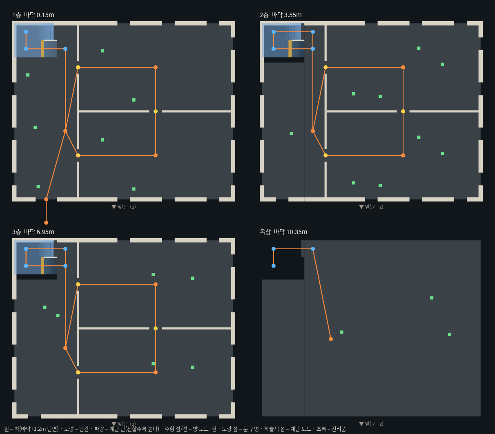
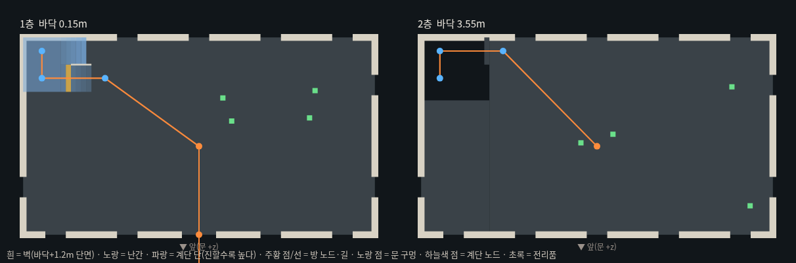
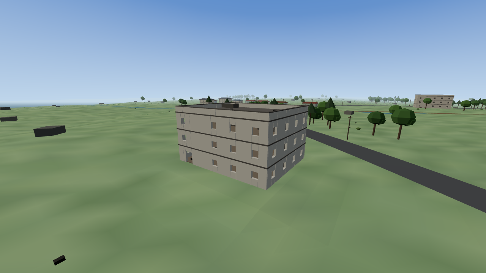

# lastdrop-07b 계단 통과 + 저택 생성 보장 + 자동 시험

카드 "[라스트 드롭 - 07-b 계단 통과 + 저택 생성 실패 (오퍼스 헤드리스 실측)]" 기록. 코드는 `lastdrop/game.js` 만 바뀌었다.

## 1. 계단 참에서 꺾기

### 고친 것
| | 07 (전) | 07-b (후) |
|---|---|---|
| 참 길이 `STAIR.land` | 1.2m | **2.2m** |
| 줄 폭 `STAIR.lane` | 1.4m | **1.6m** |
| 줄 사이 칸막이 | 참 끝까지 | **참 0.6m 앞에서 끊음** (`STAIR.cut`) |
| 계단 구역 몸 충돌 반경 | 0.45m | **0.3m** (`STAIR_ZONES` 안 — 계단 구멍 + 오르내리는 자리) |
| 계단 앞 노드 | 계단 끝 +0.6m | 계단 끝 +0.8m (비껴 들어와도 칸막이 끝에 안 걸린다) |
| 계단 구멍 | 3.0 × 3.3m | 4.0 × 3.7m (+ 띠 0.5m, 난간 그대로) |
| 저택 홀 폭 | 5m | 6m (현관도 홀 가운데로) |

집(1~2층) 계단도 같은 `makeBuilding` 이라 사막·초원 모두 같이 바뀌었다.

### 참 꺾기 통과 폭 (오퍼스 실측과 같은 방법)
참 높이에서 x 를 0.05m 씩 옮기며 줄 A 쪽 → 줄 B 쪽으로 2초 걸어 건너가는지 (초원 계단 3개):

| | 통과 x (참 안쪽 벽에서) | 통과 폭 |
|---|---|---|
| 전 (land 1.2 · lane 1.4) | 0.65~0.70 / 0.65~0.70 / 0.70~0.75m | **0.1m** — 오퍼스 실측 "0.70~0.75m, 약 5cm" 와 같다 |
| 후 (land 2.2 · lane 1.6 · 칸막이 끊음 · 반경 0.3) | 0.55~2.50 / 0.55~2.50 / 0.50~2.45m | **2.0m** |

### 머리 높이 재검사
계단 단 가운데·참 위 810 점(초원 621 · 사막 189)에서, 몸(반경 0.3) 위 0.6~1.75m 사이에 걸리는 콜라이더(위층 바닥·위 계단 등): **0곳**.

## 2. 초원 저택 생성

### 거부 사유 집계 (초원 20번 생성, 수정 전 배치 규칙 — 사유 로그만 붙임)
| 사유 | 저택 | 집 |
|---|---|---|
| 도로(rectRoad) | 0 | 2917 |
| 다른 건물 | 1 | 615 |
| 개울 | 20 | 129 |
| 터(물가 — placeBuilding) | 5 | 45 |
| 가장자리 | 0 | 0 |

- 이 집계에서 저택 수 분포는 **3채 13번 · 4채 7번 — 0채는 한 번도 없었다** (같은 07 코드).
- 오퍼스 실측 "6번 생성 → 저택 0채"와 다르다. 짐작: 07 부터 `boot(id)` 가 맵 id 를 받고, **인자 없이 `boot()` 를 부르면 사막**(저택 없음, 1~2층 집만)으로 만든다.
  "계단 건물은 1~2층 집뿐"도 사막의 모습과 맞는다. 초원은 `boot('meadow')`, 또는 화면에서 [게임 시작] → [초원].
  `MAP_ID` 로 어느 맵이 만들어졌는지 확인할 수 있다.

### 매 판 3~4채 보장 (그래도 카드대로 넣었다)
1. **1단계** — 고리 도로 가 22~34m, 후보 마을 수×12 (전엔 ×6).
2. **2단계(완화)** — 모든 도로, 30~60m, 개울 여유 9 → 4m, 후보 160.
3. **3단계(강제)** — 섬 안쪽 24m 격자를 훑어 도로·다른 건물에서 떨어진 땅 중 가장 평평한 곳(9점 높이 차, 개울 20m 안이면 감점)에 22×16 저택, 터 평탄화.

- 놓인 단계는 `MANSION_STAGE`, 거부 사유는 `PLACE_LOG` 에 남는다. 시험용 `MANSION_SKIP`(1 = 1단계 건너뜀, 2 = 1·2단계 건너뜀).

| 시험 | 결과 |
|---|---|
| 초원 20번 생성 (보통) | **3채 8번 · 4채 12번 · 3채 미만 0번** — 72채 모두 1단계 |
| 1단계를 끄고 5번 | 3·4·3·3·4채 — 모두 2단계로 |
| 1·2단계를 끄고 5번 | 3·4·3·4·3채 — 모두 3단계(강제)로 |
| 강제 배치 저택 걷기 시험 | 계단 건물 22곳 전부 통과 (아래 3과 같은 시험) |

## 3. 자동 시험 — 모든 건물 오르내리기

`h07all.js` (헤드리스): 계단이 있는 **모든 건물**에서 문 밖 2m → 문 → 1층 → 계단 → … → 맨 위층(저택은 옥상) → 다시 문 밖.

- **나** (`movePlayer` — W 만 누르고 방향만 경로 쪽으로): 걷기 · 달리기(Shift) · **비껴서** ±off (계단 노드를 줄 가운데에서 off 만큼 비껴 겨냥, 걷기·달리기 둘 다 — 사람 손 흉내).
- **봇** (`nav` 이동 그래프 + `moveEnt`).
- 실패하면 건물·누가·방향·멈춘 자리(건물 기준 좌표)·남은 웨이포인트를 낸다.

| 코드 | 맵 | 계단 건물 | 나 걷기 | 나 달리기 | 나 비껴서 | 봇 |
|---|---|---|---|---|---|---|
| 전 (07) | 초원 | 12 | 11 | 11 | **0** (±0.35) | 11 |
| 전 (07) | 사막 | 11 | 11 | 11 | **0** (±0.35) | 11 |
| 후 | 초원 ×2 | 19 · 18 | 전부 | 전부 | 전부 (±0.3) | 전부 |
| 후 | 사막 ×2 | 4 · 8 | 전부 | 전부 | 전부 (±0.3) | 전부 |
| 후 | 초원 ×2 | 11 · 13 | 전부 | 전부 | 전부 (±0.4) | 전부 |
| 후 | 사막 ×2 | 1 · 11 | 전부 | 전부 | 전부 (±0.4) | 전부 |

- 전(07)의 실패: 비껴서 오르면 전부 참(높이 1.85m)이나 줄 B 첫 단에서 멈춤 — 참 꺾기 폭 문제 그대로.
  가운데로만 걸어도 저택 1채는 문 밖에서 막혔다(문 앞에 전봇대·바위) → 07-b 에서 **문 앞 7m 통로(폭 5m)엔 나무·바위·전봇대를 안 둔다**.
- 후 중간에 찾은 것: 비껴 겨냥한 계단 앞 노드가 다음 계단 칸막이 끝에 딱 닿는 자리(0.3m)가 돼 3층에서 멈춤 → 계단 앞 노드를 0.8m 로 옮겨 해결.
- 손으로 하는 왕복(달리기 포함)은 위 "나 달리기 · 비껴서" 가 대신한다 — 저택 1층 → 옥상(10.35m) 걷기 10.0초 · 내려오기 10.6초.

## 4. 회귀

| 시험 | 결과 |
|---|---|
| 봇전 3판씩 (사막 · 초원) | 오류 0 · 계단 끼임 0 · 포기 0~1 · 위층 줍기 사막 4/13/5, 초원 13/21/10 · 프레임 로직 0.12~0.14ms |
| 레드존 피해 (9발) | 저택 1~3층 모든 방·집 안 0, 옥상·지붕 위·문 밖·들판 552 |
| 봇 레드존 | 어려움 이상 2.9~3.1초에 덮인 자리, 쉬움은 원 밖 91m |
| 높은 곳 | 초원 저택 옥상 8.0초, 사막 2층 4.0초 |
| 지프 도로 주행 | 6초 116m, 도로 중심 그대로 |
| `node --check lastdrop/game.js` | 통과 |

