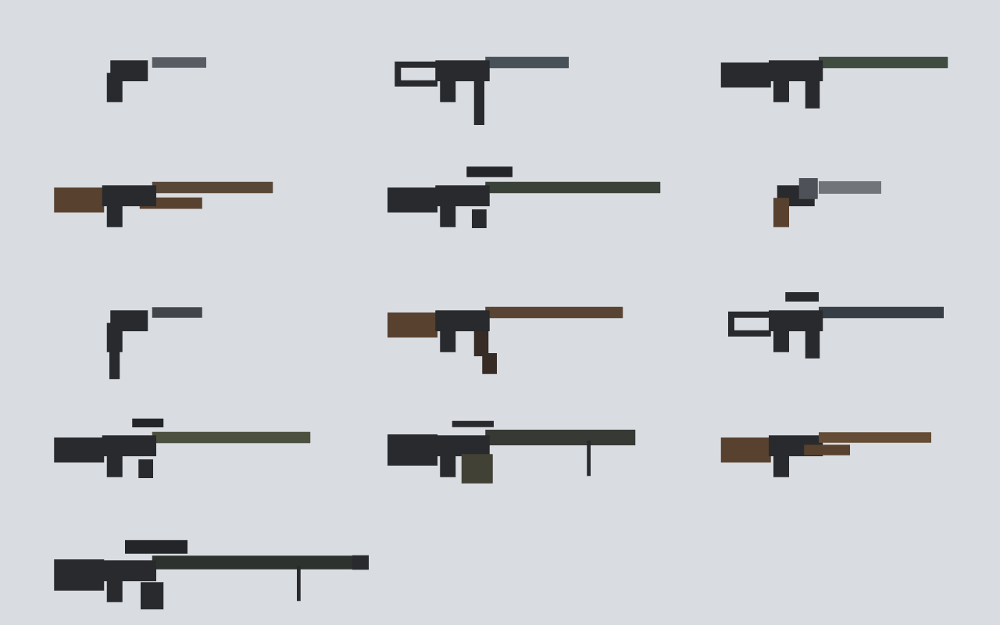

# lastdrop-08 - 총기 추가 8종

## 무엇을 했나
- 총 8종(리볼버·기관권총·돌격소총 K·점사소총·지정사수총·경기관총·쌍발 샷건·대물저격총)과 새 탄 `.50` 을 넣었다. 수치는 오퍼스 확정 초기값 그대로다(정현 조정용).
- 바닥 총 스폰을 희귀도 가중치(흔함 3 · 보통 2 · 희귀 1 · 보급 전용 0)로 바꾸고, 탄 스폰도 그 비율을 따르게 했다. 보급 상자는 예전 저격 대신 대물저격총과 .50 을 준다.
- 1인칭 총과 봇 손의 총(새로 생김)을 한 함수 `gunParts` 로 만든다. 총마다 실루엣과 총소리가 다르다. 봇은 점사·쌍발을 각 방식대로 쏘고, 경기관총은 중거리, 지정사수총은 원거리에서 싸운다.

## 총기표 (GUNS — 표 그대로)

| 이름 | k | 분류 | 탄 | dmg | rate | mag | eff | fly | lo | spread | kick | reload | 희귀도 | 특수 |
|---|---|---|---|---|---|---|---|---|---|---|---|---|---|---|
| 리볼버 | revolver | 권총 | 7.62 | 48 | 0.55 | 6 | 60 | 600 | 0.5 | 0.009 | 2.2 | 2.6 | 보통 | |
| 기관권총 | mpist | 권총 | 9mm | 13 | 0.06 | 20 | 40 | 600 | 0.5 | 0.028 | 1.0 | 1.6 | 흔함 | 연사 |
| 돌격소총 K | akr | 주무기 | 7.62 | 34 | 0.11 | 30 | 220 | 600 | 0.65 | 0.014 | 2.0 | 2.5 | 보통 | 연사 |
| 점사소총 | burst | 주무기 | 5.56 | 30 | 0.07 (점사 안) · 점사 사이 0.3 | 30 | 240 | 600 | 0.65 | 0.011 | 1.4 | 2.4 | 보통 | 클릭 1번 = 3발 |
| 지정사수총 | dmr | 주무기 | 7.62 | 55 | 0.35 | 10 | 450 | 600 | 0.75 | 0.004 | 2.6 | 2.8 | 희귀 | 우클릭 줌 시야 37° |
| 경기관총 | lmg | 주무기 | 5.56 | 26 | 0.085 | 75 | 200 | 600 | 0.6 | 0.020 | 1.5 | 5.0 | 희귀 | 들고 있으면 이동 ×0.85 |
| 쌍발 샷건 | dbl | 주무기 | 12g | 14 × 9펠릿 | 0.25 | 2 | 15 | 40 | 0 | 0.070 | 3.4 | 2.2 | 흔함 | 샷건 감쇠 · 2발 쏘면 바로 재장전 |
| 대물저격총 | amr | 주무기 | .50 | 140 | 2.2 | 5 | 700 | 800 | 0.85 | 0.0015 | 5.0 | 3.6 | 보급 전용 | 조준경 · 머리면 헬멧·방탄 3레벨도 한 방 |

- 새 탄: `.50` — 한 발 무게 1.5, 줍는 단위 10발. **보급 상자에만** 있다(바닥 스폰 없음).
- 봇이 싸울 거리를 정하는 `range` 는 표에 없어 내가 정했다: 리볼버 60 · 기관권총 40 · 돌격소총 K 130 · 점사 130 · 지정사수 220 · 경기관총 120 · 쌍발 16 · 대물 350.
- 슬롯: `cls` 에 권총/주무기를 적었다. 핫바는 06 규칙 그대로라 칸 제한은 없다(분류는 표시·문서용).
- 이름에 실존 총기 상표는 안 썼다.

## 희귀도표 (바닥 스폰 가중치)

기존 5종의 희귀도는 카드에 없어 **내가 정했다 — 확인 바람.**

| 희귀도 | 가중치 | 총 | 한 자루당 확률 |
|---|---|---|---|
| 흔함 | 3 | 권총 · 샷건 · 기관권총 · 쌍발 샷건 | 12% |
| 보통 | 2 | SMG · 소총 · 리볼버 · 돌격소총 K · 점사소총 | 8% |
| 희귀 | 1 | 저격 · 지정사수총 · 경기관총 | 4% |
| 보급 전용 | 0 | 대물저격총 | — |

가중치 합은 25. 3층·옥상은 예전처럼 순위 3 미만이 나오면 한 번 더 굴린다.
탄 상자는 총 가중치대로 나온다: 9mm 8/25 (32%) · 12g 6/25 (24%) · 7.62 6/25 (24%) · 5.56 5/25 (20%). `.50` 은 0.

## 형태 · 소리



왼쪽 위부터 권총 · SMG · 소총 / 샷건 · 저격 · 리볼버 / 기관권총 · 돌격소총 K · 점사소총 / 지정사수총 · 경기관총 · 쌍발 샷건 / 대물저격총. 상자만 쓰고 텍스처는 없다.
- 길이 · 총열 수(쌍발은 두 줄) · 탄창 모양으로 구분한다: 리볼버는 실린더, 기관권총은 손잡이 밑으로 긴 탄창, 돌격소총 K 는 꺾인 탄창, 경기관총은 큰 탄통, 쌍발은 탄창 없음.
- 개머리판: 권총류는 없음, SMG·점사는 뼈대, 샷건·쌍발·돌격소총 K 는 나무색. 점사는 운반 손잡이, 지정사수총은 짧은 조준경, 경기관총·대물은 양각대, 대물은 큰 소염기.
- 봇 손의 총: 봇 메시 오른쪽 가슴 높이에 같은 모양을 붙인다. 든 총이 바뀔 때만 모양을 갈아 끼운다(총마다 한 번 만들어 같이 씀).
- 총소리 `snd:[잡음 높이, 길이, 쿵 시작 높이]` 는 13종 모두 다르다. 기존 권총·SMG·소총은 같은 소리였는데 이번에 조금씩 갈랐다(소총은 예전 그대로).

## 바꾼 동작
- **점사** (나): 클릭 한 번에 3발을 0.07초 간격으로 쏜다. 마지막 발 뒤 0.3초 쉰다. 누르고 있으면 점사를 반복한다. 총을 바꾸면 남은 점사는 취소된다.
- **쌍발**: 두 발을 다 쏘면 클릭 없이 바로 재장전을 시작한다.
- **경기관총**: 들고 있으면 내 이동과 봇 이동이 모두 ×0.85.
- **지정사수총**: 우클릭하면 시야 37°(2배)가 된다. 조준경 덮개 없이 십자선이 남는다. 다른 총은 그대로다(52°, 저격·대물 20°).
- **대물저격총**: 머리에 맞으면 피해를 `(hp+1)/(1-0.47)` 이상으로 올린다. 수치로도 140×2×0.53 = 148 이라 원래 한 방이지만, 확실히 하려고 넣었다.
- **연사 간격 보정 (모든 총, 나·봇)**: 쿨다운이 0 아래로 넘친 시간을 다음 발로 넘긴다. 넘치는 양은 최대 한 프레임이다. 이게 없으면 60fps 에서 0.06초 총이 0.067초로 쏴 표대로 안 나온다. **기존 총도 표값에 가까워진다**(예: SMG 60fps 0.083→0.075초). 밸런스가 약간 바뀌니 확인 바람.
- **봇**:
  - 점사는 3발씩 붙여 쏘고 0.3초 + 쉼, 쌍발은 두 발 붙여 쏜 뒤 재장전한다.
  - 경기관총은 32m 를 유지한다. 지정사수총·대물은 `min(60, 시야×0.7)` m 까지 다가가고 그 안에선 거리를 지킨다.
  - 경기관총은 쉼을 절반으로 줄이고 한 번에 길게(6~11발) 긁도록 했다. 단, 아래 이슈 1번 때문에 지금은 효과가 거의 없다.
  - 줍기 순위 `GUN_RANK`: 권총 1 · 기관권총/리볼버/샷건/쌍발 2 · 저격/지정사수/SMG 3 · 소총/돌격소총 K/점사/경기관총 4 · 대물 5.

## 변경 파일 목록
- `lastdrop/game.js`: GUNS 8종 · `.50` · `GI`/`pickGun` · 스폰 가중치 · 보급 · `gunParts`/`gunGeo`/`handGun` · 점사/쌍발/감속/줌/한 방 · 봇 사격/거리 · 연사 보정 · 총소리
- `lastdrop/index.html`: 조작 안내 "저격·대물저격은 배율, 지정사수총은 2배"
- `tests/lastdrop/guns.js` · `botguns.js` · `botmatch.js` (새 시험) · `tests/lastdrop/README.md`
- `docs/lastdrop-08-guns.md` · `docs/img/lastdrop-08-guns.png`

## 실행 명령
```bash
python3 -m http.server 8761 --directory ~/land-grab-game &
google-chrome --headless=new --remote-debugging-port=9461 --user-data-dir=/tmp/ld-cdp about:blank &   # 시험마다 새로 띄운다
U=http://127.0.0.1:8761/lastdrop/index.html; cd tests/lastdrop
python3 run.py 9461 $U guns.js '{"map":"meadow"}'
python3 run.py 9461 $U botguns.js '{"map":"desert","guns":["burst","dbl","lmg","dmr","mpist","revolver","akr","rifle"]}'
python3 run.py 9461 $U botmatch.js '{"map":"meadow"}'    # 3판: meadow · desert · meadow
./deploy.sh
```

## 검증 (헤드리스 크롬)

### 총별 — 나, 120fps, 방아쇠를 계속 누름 (`guns.js`)
| 총 | 탄창 | 연사(초) | 재장전(초) | 몸통 피해 (거리) / 표값 |
|---|---|---|---|---|
| 권총 | 15 | 0.26 | 1.508 | 22 (20m) / 22 |
| SMG | 30 | 0.075 | 1.9 | 15 / 15 |
| 소총 | 30 | 0.12 | 2.308 | 29 / 29 |
| 샷건 | 5 | 0.852 | 2.708 | 92.2 (5m) / 91.5 |
| 저격 | 5 | 1.452 | 3.0 | 92 / 92 |
| 리볼버 | 6 | 0.55 | 2.6 | 48 / 48 |
| 기관권총 | 20 | 0.06 | 1.6 | 13 / 13 |
| 돌격소총 K | 30 | 0.11 | 2.5 | 34 / 34 |
| 점사소총 | 30 | 점사 안 0.07 · 사이 0.3 | 2.4 | 30 / 30 |
| 지정사수총 | 10 | 0.351 | 2.808 | 55 / 55 |
| 경기관총 | 75 | 0.085 | 5.008 | 26 / 26 |
| 쌍발 샷건 | 2 | 0.258 | 2.208 (2발째에 자동 시작) | 102.2 (5m) / 100.8 |
| 대물저격총 | 5 | 2.202 | 3.608 | 140 / 140 |

- 재장전·연사의 +0.008초는 한 프레임(1/120초)이다. 샷건 피해의 ±1~2 는 표값을 몸 가운데 거리로 계산해서 생긴다(실제로는 몸 앞면에 맞는다).
- **점사 클릭 1번** → 3발, 간격 0.075 · 0.067초. **쌍발** 클릭 → 2발 뒤 재장전 중, 남은 탄 0.
- **헬멧·방탄 3레벨, 머리**: 대물 100m → 148.4 피해, 죽음. 대물 300m → 148.4, 죽음. 비교로 저격 100m → 97.5, 생존.
- **이동 1초 (W)**: 소총 5.60m · 경기관총 4.76m → **비율 0.85**.
- **줌**: 소총 52° · **지정사수총 37°** (조준경 덮개 없음) · 저격 20° · 대물 20° (조준경).
- **보급 상자**: 대물저격총 + .50 10발. 초원 한 판의 바닥 스폰에는 **대물 0 · .50 0** 이었다.
- **초원 한 판 바닥 총**: SMG 17 · 샷건 15 · 소총 15 · 권총 13 · 쌍발 11 · 기관권총 10 · 점사 9 · 돌격소총 K 9 · 리볼버 7 · 저격 7 · 경기관총 3 · 지정사수 1 (합 117). 탄: 9mm 23 · 7.62 20 · 12g 19 · 5.56 15.
  한 판 표본이라 들쭉날쭉하고, 3층·옥상 다시 굴리기가 보통·희귀 쪽으로 끈다.
- 총소리 13종 겹침 0. 모양 13종 모두 조각 수·크기가 다르다(그림 위).

### 봇 — 어려움 봇에 총을 쥐여 나(무적)와 16초 (`botguns.js`, 사막, 45m 에서 시작)
| 총 | 발 | 묶음(쉼 0.2초 기준) | 묶음 안 간격 | 싸운 거리(8~16초 평균) | 손 모델 |
|---|---|---|---|---|---|
| 점사소총 | 68 | 3,3,3,3,3,… | 0.07 | 26.0m | ✓ |
| 쌍발 샷건 | 10 | 2,2,2,2,2 | 0.25 | 8.8m | ✓ |
| 경기관총 | 115 | 74, 40 | 0.085 | **32.0m** | ✓ |
| 지정사수총 | 20 | 1씩 | — | **45.0m** (다가오지 않음) | ✓ |
| 기관권총 | 109 | 19,20,20,… | 0.06 | 22.0m | ✓ |
| 리볼버 | 14 | 1씩 | — | 26.0m | ✓ |
| 돌격소총 K | 86 | 29,30,26 | 0.11 | 26.0m | ✓ |
| 소총 (비교) | 81 | 29,30,21 | 0.12 | 26.0m | ✓ |

### 봇전 3판 (봇 15기, 나는 숨김, 자기장 ×0.6, 30fps) — 모두 완주
| 맵 | 경기 | 남은 봇 | 오류 | 봇이 주운 새 총 | 새 총으로 쏜 발 | 처치(총) |
|---|---|---|---|---|---|---|
| 초원 | 169초 | 1 | 0 | 쌍발 1 · 리볼버 1 · 기관권총 2 · 지정사수 2 · 경기관총 1 · 점사 1 | 경기관총 34 · 리볼버 8 | 경기관총 7 · 권총 2 |
| 사막 | 158초 | 1 | 0 | 점사 3 · 리볼버 3 · 돌격소총 K 2 · 지정사수 1 | 점사 71 · 돌격소총 K 33 · 리볼버 1 | 점사 5 · 돌격소총 K 4 |
| 초원 | 168초 | 1 | 0 | 쌍발 2 · 경기관총 1 · 기관권총 1 · 점사 1 · 돌격소총 K 1 | 점사 17 · 쌍발 2 · 돌격소총 K 30 | 소총 3 · 권총 2 · 점사 1 · 돌격소총 K 1 · SMG 1 |

나머지 사망은 자기장·레드존(처치자 없음)이다.

## 문법 검사 결과
- `node --check lastdrop/game.js` 통과. `index.html` 은 인라인 스크립트가 없다(외부 game.js 만).
- `node --check tests/lastdrop/{guns,botguns,botmatch}.js` 통과.

## 새 커밋 해시
- (아래 커밋 뒤 채움)

## 감독 확인 요청 사항 / 남은 이슈
1. **기존 버그 (이번에 안 고침) — 봇이 한 번 쉰 뒤로는 안 쉰다.** `b.burst` 가 0 이 되는 그 발에서 바로 2~5 로 다시 채워져 `rnd(T.rest)` 쉼이 첫 묶음에만 들어간다. 그래서 연사 총 봇은 탄창을 통째로 긁는다(위 표의 29·30발 묶음). 예전 코드도 같고, lastdrop-01 난이도 밸런스가 이 상태로 맞춰졌다. 고치면 모든 봇이 약해지므로 따로 지시 바람. 경기관총의 "길게 긁기"·쉼 절반도 이 버그 때문에 지금은 차이가 거의 없다.
2. **기존 5종 희귀도**(권총·샷건 흔함 / SMG·소총 보통 / 저격 희귀)는 내가 정했다.
3. **연사 간격 보정**으로 기존 연사 총의 실제 연사가 표값에 맞춰 조금 빨라졌다(60fps 에서 SMG 약 +11%, 소총 0.133→0.12초).
4. 지정사수총 줌은 조준경 덮개 없이 십자선을 쓴다. 덮개(2배 조준경 그림)가 필요하면 지시 바람.
5. 봇은 보급 상자를 안 연다(예전과 같다). 그래서 봇이 대물저격총을 갖는 일은 없다.
6. 시험 하네스: 헤드리스 크롬 한 탭에서 시험을 연달아 돌리면 두 번째가 멈춰, 시험마다 크롬을 새로 띄웠다.
7. 다음 단계 09(투척류: 수류탄·섬광탄)는 **컨펌 뒤에 시작한다.**
