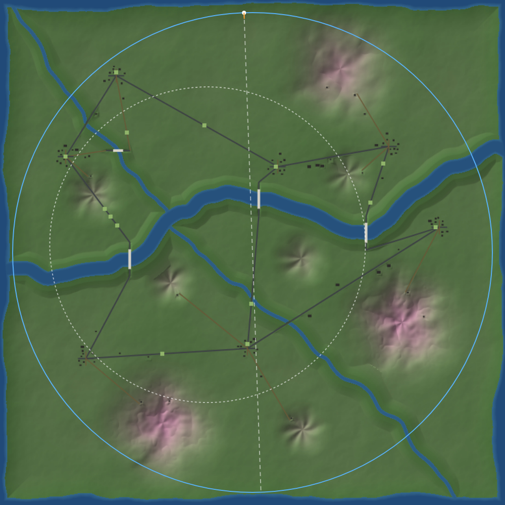
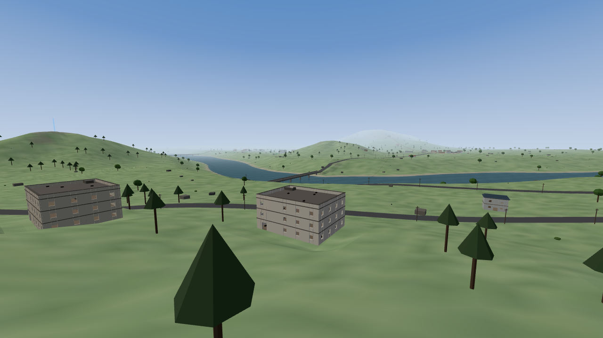
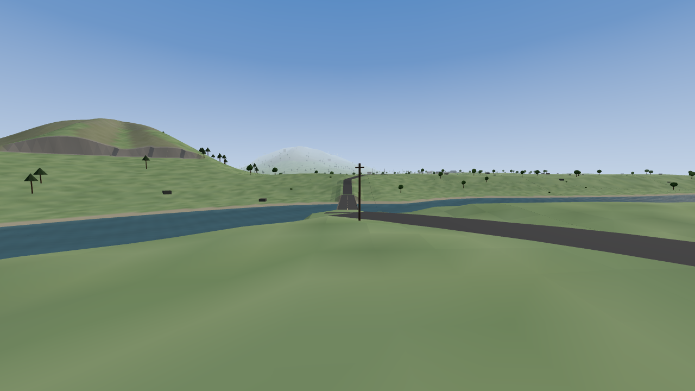
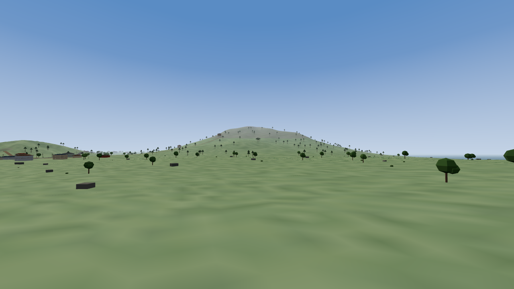

# lastdrop-10 - 새 맵 '산지' (mountain)

## 무엇을 했나
- 맵 키 `mountain`(산지)을 새로 넣었다. 한 변 3,200m(기존 1,000m 넓이의 10.2배), 16명.
  - 지형: 언덕 + 작은 산 5~7 + 중간 산 2~3. 능선·골짜기가 있고 40° 넘는 땅은 미끄러진다.
  - 물: 섬을 가로지르는 강 본류 + 지류 1~2. 수영할 수 있다.
  - 다리 4(본류 3 + 지류 1)와 도로망, 마을 5~7, 3층 주택 6~8, 창고·헛간, 주유소, 산장·오두막, 감시탑.
- 크기에 맞춰 늘렸다: 자기장 8단계(대기·수축 합 860초), 항로 48초, 레드존 200m, 보급 3회, 지프 14대, 바깥 전리품 5배, 작은 지도 창 700m + M 키 전체 지도.
- 성능: 지형은 200m 구역 × LOD 4단계, 건물·나무는 400m 구역 합치기 + 1,250m 밖 숨김. 섬 만들기 0.9초(목표 5초), 진행 막대가 있다.
- 봇: 강을 건널 때 다리를 쓰고, 다리가 멀면 헤엄친다(헤엄 중엔 안 쏜다). 다음 자기장이 강 건너면 미리 건넌다. 어려움 이상은 높은 곳을 고른다. 지프는 안 탄다.



| 마을·저택 단지에서 본 강과 다리 | 다리 경사로 | 중간 산 |
|---|---|---|
|  |  |  |

## 수치표

### 지형
| 항목 | 값 |
|---|---|
| 크기 | 3,200 × 3,200m (`half:1600`), 높이 격자 4m (801×801) — 사막·초원은 그대로 1,000m · 2m |
| 언덕 | fbm 3겹, 바탕 높이 약 8~33m |
| 작은 산 | 5~7개 · 반경 170~260m · **둘레 땅 위 43~70m** (실측, 아래 시드 3개) |
| 중간 산 | 2~3개 · 반경 400~490m · **둘레 땅 위 112~131m** (실측) |
| 산 모양 | 봉우리에서 뻗는 능선 4~6줄(각도를 노이즈로 비틂). 사이는 골짜기이고 아래로 갈수록 깊다. ridged 노이즈로 잔 능선. 원뿔이 아니다 |
| 미끄러짐 | 경사 > 40°(`SLIDE = tan40°`)인 **지형** 위에선 내리막으로 7m/s(지프 5m/s) 밀리고, 40° 넘는 오르막은 못 오른다. 사람·봇·지프 공통. 콜라이더(건물·다리) 위는 해당 없음 |
| 40° 넘는 땅 | 섬 땅의 0.1~0.2% (산 꼭대기 부근 절벽) |
| 수목 | 산: 침엽수 1,100~1,150 (수목한계 = 봉우리 높이의 86%, 경사 45° 넘으면 안 심음) · 언덕: 활엽수 ~750, 바위 ~500, 덤불 |
| 땅 색 | 강바닥·물가 모래·풀(3가지)·높은 풀밭(70m~)·바위(경사 > 43° 또는 118m~) |
| 절개면 | 도로·건물 터·다리 경사로를 고를 때 둘레를 높이 차 × 1.7(약 30°)만큼 넓힌다. 처음엔 6~7m 고정이라 40° 넘는 절개면에 봇이 막혔다. **산지만**이고 사막·초원은 예전 그대로 |

### 강
| 항목 | 본류 | 지류 (1~2개) |
|---|---|---|
| 줄기 | 섬 밖 바다 → 섬 밖 바다, 가운데에서 ±300m 비껴 굽이침 | 본류 30~70% 지점에서 옆으로(본류 방향 ±0.7rad 안) 섬 가장자리까지 |
| 수면 폭 (실측) | 81.5~92m (굽이가 겹치는 곳은 106m) | 24~24.5m |
| 헤엄 폭 (깊이 > 1.3m) | **81.5~82m** | 17.5m |
| 가운데 깊이 | 4.6m (바닥 반폭 30m) | 2.4m |
| 둑 | 물가 30m 는 9°(걸어 나온다), 그 밖은 19°로 올라 원래 땅과 만난다 | 같다 |
| 물 표면 | 높이 0 의 판 하나(강·지류·바다 공통). 불투명도 0.74, 잔물결은 셰이더에서 법선·색만 흔든다(텍스처 없음) | |

### 수영
| 항목 | 값 |
|---|---|
| 들어가는 깊이 | 가슴 1.3m 보다 깊은 물에 몸이 내려가면 |
| 몸 · 카메라 | 발 = 수면 −1.45m, 눈 = 수면 +0.12m (실측 0.1m) |
| 속도 | 2.7m/s, 달리기·점프·앉기 불가 |
| 못 하는 것 | 사격(주먹 포함) · 재장전 · 조준 · 치료. 총은 등에(1인칭 총을 숨긴다). 들어가는 순간 치료·재장전이 끊긴다 |
| 피격 | 머리 부위만, 그것도 수면 위 부분만 |
| 봇 | 같은 판정. 헤엄 중엔 안 쏘고 싸움 움직임 대신 마저 건넌다 |
| 지프 | 바닥이 수면 −0.8m 보다 깊은 곳엔 안 들어간다(둑에서 멈춤). 억지로 그런 곳에 있으면 1.5초 뒤 침수·파괴 |

### 다리 (시드 1001 · 1002 · 1003)
| 항목 | 값 |
|---|---|
| 수 | 4 = 본류 3(안쪽 구간 22·50·78% 근처에서 강이 축과 가장 잘 맞는 마디) + 지류 1 |
| 방향 | 축 정렬(콜라이더가 축 정렬 상자라). 강이 z 쪽으로 흐르면 x 축 |
| 상판 | 폭 10m · 두께 0.8m · 높이 = max(수면 +6m, 상판 아래 땅 최고점 +0.3) → 실측 모두 6m. 아래로 헤엄쳐 지나간다(머리 위 4.4m) |
| 길이 | 본류 124~136m, 지류 60~64m |
| 난간 · 교각 | 양쪽 1.1m 난간, 24m 마다 교각(1.6m 각) |
| 경사로 | 양 끝, 흙을 쌓거나 깎아 상판 높이 → 원래 땅. 길이 45~140m(22° 안쪽, 거의 곧은 기울기). 상판 밑 6m 도 상판 높이로 채운다 — 4m 격자 보간으로 끝이 꺼져 상판 밑으로 걸어 들어가던 것 |
| 도로 | 다리·경사로가 도로 목록에 들어간다. 경사로 끝은 그쪽의 가장 가까운 마을과 잇는다 |

### 건물 · 도로 (시드 3개 범위)
| 종류 | 수 | 비고 |
|---|---|---|
| 마을 | 5~7 | 낮고 평평한 땅, 강 130m · 산 밖. 본류 양쪽에 둘 이상씩 |
| 3층 넓은 주택(저택) | 6~7 (목표 6~8) | 07 저택 생성기 그대로(층마다 홀·앞방·뒷방 + 옥상). 포장도로 가 2~3곳에 모아 단지로 |
| 마을 집 1~2층 | 44~60 | 마을마다 8~12 |
| 창고 · 헛간 | 7~10 | 마을 가장자리 1~2 |
| 주유소 | 2 | 캐노피(기둥 4 + 지붕 콜라이더) + 주유기 2 + 뒤 가게(1층 집) |
| 산장(2층) · 오두막(1층) | 3~6 | 산 중턱, 산길 끝에서 16m 옆 |
| 감시탑(3층 + 옥상) | 3~7 | 산 중턱, 9×9m |
| 외딴집 | 10 | 도로 가 |
| 계단 있는 건물 | 31~49 | 07/07-b/07-c 공통 함수 그대로 |
| 도로 | 포장(마을↔마을 같은 쪽, 다리↔마을) · 골목 · 흙 산길(마을 → 산 중턱) | 본류를 가로지르는 길은 안 만든다. 지류는 둑길로 넘는다(수면 +0.8m) |
| 도로 연결 | **세 시드 모두 한 덩어리**(다리 4개 포함) | |
| 콜라이더 · 전리품 · 지프 | 6,200~7,300 · 840~940 · 14 | |

### 규칙 (산지만, 사막·초원은 예전 값)
| 항목 | 사막·초원 | 산지 |
|---|---|---|
| 자기장 | 6단계 288초 | 8단계 대기·수축 합 860초 — [대기, 수축, 다음 반경] = [100,80,1000] [85,70,640] [70,60,400] [60,50,240] [50,45,130] [40,35,60] [35,30,22] [25,25,4]. 시작 반경 1,520m |
| 자기장 피해 | 1~14 | 8단계까지 늘림 (…, 18, 22) |
| 항로 | 30초 | 48초 (같은 속도로 길이 ∝ 맵) |
| 낙하산 | 고도 70m | **땅 위** 70m (산이 150m) |
| 레드존 | 반경 85m · 62초마다 | 200m · 80초마다 |
| 보급 상자 | 2회 (95·205초) | 3회 (150·330·510초) |
| 지프 | 5 | 14 (도로 위, 다리·경사로·산길 빼고) |
| 바깥 전리품 | 70 | 357 (5배 — 나머지는 건물 수만큼 는다) |
| 봇 착지 | — | 200m 안에 이미 둘이 내리면 다른 자리 (한 마을에 몰려 첫 1분에 판이 끝나던 것) |
| 안개 · 시야 | 90~560m · 1,400m | 260~1,300m · 2,300m, 하늘 구 ×1.9(나를 따라온다) |
| 작은 지도 | 섬 전체 | 내 둘레 700m (지형을 미리 그린 그림 위) |
| 큰 지도 (M) | — | 섬 전체 900px, 항로·자기장·레드존·보급·지프 |

## 봇
- **강 건너기**(`riverWay`): 길이 강을 가로지르면 그 강의 다리 중 [경사로 끝 → 상판 끝 → 상판 끝 → 경사로 끝]을 거친다. 다리로 도는 길이 곧장보다 1.6배 + 250m 넘게 길면 헤엄친다. 이미 지난 다리 웨이포인트(경사로 위 등)는 뺀다.
- **다음 자기장이 강 건너**: 다음 원 중심 쪽 nr×0.4 지점을 한 번 목표로 잡아 건넌다(`b.cross`). 다음 원(nr 85%) 밖이고 거기까지 걷는 데 남은 시간을 거의 다 쓰면(`zoneLate`) 줍기 대신 이동한다.
- **높은 곳**: 어려움 이상은 배회할 때 6자리 중 가장 높은 곳(강 건너·자기장 밖 제외)을 고른다.
- **헤엄 중**: 안 쏘고, 치료 안 하고, 싸움 움직임 대신 길을 마저 간다.
- **길 다시 만들기(모든 맵)**: 예전엔 "5초 동안 웨이포인트를 못 지우면" 다시 만들었다. 지금은 "5초 동안 웨이포인트를 못 지우고 그 웨이포인트에 가까워지지도 않으면"이다. 산지는 한 구간이 수백 m 라, 경사로를 걷다 5초마다 경로를 다시 만들어 경사로 끝으로 되돌아가길 반복했다.
- 지프 탑승은 안 함(다음 단계).

## 변경 파일 목록
- `lastdrop/game.js`:
  - 맵별 규칙(`applyMapRules` — HALF·격자·자기장·항로·레드존·보급·시야)과 `MAPS.mountain`, `mountainPrep`
  - 강(`carveRiver`·`riverDist`·`riverCross`), 다리(`makeBridge`·`deckAt`), 주유소, `buildMountain`
  - 지형 LOD(`buildTerrainTiles`), 물(`buildWater`)
  - 수영(`swimCheck`)·미끄러짐(`slideStep`, `canStep` 경사 제한), 지프 물·경사·상판
  - 지도(`buildMapBg`·`drawMapTo`·M 키), `bootAsync` 진행 막대, 봇 강 건너기·자기장·높은 곳, 착지 분산
  - `?seed=` (시험용 같은 섬)
- `lastdrop/index.html`: 맵 카드 [산지], 큰 지도, 진행 막대, 조작 안내 M
- `tests/lastdrop/mtgen.js` · `mtplay.js` · `botcross.js` · `perf.js` (새 시험), `botmatch.js`(speed·norender·cap 옵션, 프레임 시간·수영·다리 집계)
- `docs/lastdrop-10-mountain.md` · `docs/img/lastdrop-10-{map,village,bridge,mtn}.png`

## 실행 명령
```bash
python3 -m http.server 8761 --directory ~/land-grab-game &
google-chrome --headless=new --remote-debugging-port=9461 --user-data-dir=/tmp/ld-cdp about:blank &   # 시험마다 새로 띄운다
U='http://127.0.0.1:8761/lastdrop/index.html?seed=1001'; cd tests/lastdrop
python3 run.py 9461 $U mtgen.js '{"map":"mountain"}'
python3 run.py 9461 $U mtplay.js '{"map":"mountain"}'
python3 run.py 9461 $U botcross.js '{"map":"mountain"}'
python3 run.py 9461 $U botmatch.js '{"map":"mountain","speed":1,"norender":1,"cap":1100}'
python3 run.py 9461 $U stairs.js '{"map":"mountain","off":0.3}'
python3 run.py 9461 $U indoor.js '{"map":"mountain","seed":1,"sec":30}'
python3 run.py 9461 $U perf.js '{"map":"mountain"}'      # 비교 "meadow"
./deploy.sh
```
모든 산지 시험은 첫머리에서 `MAP_ID === 'mountain'` 을 확인한다(틀린 키면 사막으로 떨어지는 것을 막는다).

## 검증 (헤드리스 크롬, 시드 1001 · 1002 · 1003)

### 봇전 3판 — 자기장 시간 그대로, 30fps, 나는 숨김
| 시드 | 경기 | 끝난 단계 | 오류 | 봇 수영(봇·초) | 다리 길 / 헤엄 길 | 강 건너기 계획 | 우승 |
|---|---|---|---|---|---|---|---|
| 1001 | **13.1분** (789초) | 5 | 0 | 99 | 64 / 25 | 22 | 보통 · 지정사수총 |
| 1002 | **13.2분** (794초) | 6 | 0 | 473 | 106 / 27 | 9 | 보통 · 점사소총 |
| 1003 | **13.0분** (780초) | 5 | 0 | 137 | 33 / 10 | 3 | 어려움 · 경기관총 |

처음 판은 8.6분이었다. 원인은 둘: 봇이 항로 아래 한 마을에 몰려 첫 85초에 11명이 죽었고, 강을 건너다 끼어 자기장에 죽었다. 착지 분산·경로 다시 만들기·`zoneLate` 를 고친 뒤 위 값이 나왔다.

### 강 · 수영 · 다리 · 미끄러짐 (`mtplay.js`, `botcross.js`)
| 시험 | 1001 | 1002 | 1003 |
|---|---|---|---|
| 본류 헤엄 횡단 (다리에서 580~680m 떨어진 곳, Shift 누른 채) | **30.3초** | **30.3초** | **30.3초** |
| 수영 중 사격 / 치료 / 조준 | 거부("수영 중 — 총을 쓸 수 없다") / 안 됨 / 안 됨 | 같음 | 같음 |
| 헤엄치는 봇 겨누기: 몸통 · 다리 · 머리 (비교: 물 밖 몸통) | 빗나감 · 빗나감 · **머리** (몸) | 같음 | 같음 |
| 다리 4개 — 사람 걷기 (경사로 끝 → 끝, 초) | 38.2 · 37.9 · 38.6 · 27.1, 물에 빠짐 0 | 37.9 · 39.3 · 37.9 · 26.4 | 37.9 · 37.9 · 40.0 · 27.1 |
| 다리 4개 — 지프 (초) | 10.2 · 10.1 · 10.3 · 7.5, 상판 위 높이 차 0 | 10.1 · 10.5 · 10.1 · 7.3 | 10.1 · 10.1 · 10.7 · 7.5 |
| 지프로 강둑에서 물로 | 땅이 수면 −0.8m 인 곳(강 가운데에서 43m)에서 멈춤 | 같음 | 같음 |
| 지프를 깊은 물 한가운데 놓음 | 1.5초 뒤 침수·파괴 | 같음 | 같음 |
| 미끄러짐 (경사 57° · 44° · 46°) — 사람 1초 | 8.2m 내려감 | 6.5m | 7.8m |
| 같은 자리에서 오르막으로 W 3초 | 오름 0m | 0m | 0m |
| 봇 1초 / 지프 1초 | 8.2m / 8.2m | 6.5m / 4.7m | 7.8m / 5.6m |
| 봇 다리 건너기 (다리 앞 150m → 건너편 150m) | 4/4 · 120~123초 | 4/4 | 다리 4/4 건넘. 그중 1번은 건너편 시험 목표점(언덕 39m) 18m 앞에서 멈춤 |
| 봇 헤엄 건너기 (다리가 먼 곳) | 66초 중 헤엄 30초 | 같음 | 같음 |

헤엄 속도: 82m / 30.3초 = 2.7m/s. Shift 를 눌러도 같다. 한 프레임 최대 5.6m/s 는 걷다가 물에 들어가는 그 프레임이다.

### 07 시리즈 회귀
| 시험 | 결과 |
|---|---|
| `stairs.js` **산지** (시드 1001) | 건물 96 · 계단 건물 49 — 나걷기 49 · 나뛰기 49 · 나비껴서 49 · 봇 49, **실패 0**, 저택 7 |
| `indoor.js` **산지** (시드 1002, 31채 × 6명 × 30초) | 334,800 프레임 — **완전 갇힘 0 · 벽 속 0 · 관통 0** (구석 멈춤 1) |
| `stairs.js` 초원 · 사막 | 23/23 · 13/13 전부 통과 |
| `indoor.js` 초원 · 사막 | 갇힘 0 · 벽 속 0 · 관통 0 |
| `headroom.js` 초원 · 사막 | 머리 막힘 0 |
| `botmatch.js` 초원 · 사막 (×0.6) | 175초 · 177초, 오류 0. 사막은 마지막 둘이 같은 프레임에 자기장에 죽어 남은 봇 0 |
| `guns.js` 초원 (08) | 점사 3발 · 대물 헬멧3 한 방 · 경기관총 0.85 · 지정사수 37° · 보급 대물+.50 그대로 |

### 성능
| 맵 | 만드는 시간 | 단계 (ms) |
|---|---|---|
| 산지 | **0.88~0.94초** (시드 3개) | 지형 212 · 강·도로·건물 254 · 지형 그리기 453 · 전리품·사람 18 · 마무리 4 |
| 초원 | 0.19초 | 67 · 64 · 46 · 8 · 6 |

| 자리 (1280×720) | 산지: 그리기 ms · 삼각형 · 드로콜 | 초원 |
|---|---|---|
| 마을/저택 앞 | 1.4 · 214k · 180 | 0.2 · 226k · 10 |
| 섬 가운데 | 1.4 · 204k · 114 | 0.2 · 227k · 31 |
| 가장 높은 산 꼭대기 → 섬 가운데 | 1.7 · 223k · 212 | — |
| 다리 위 | 1.2 · 181k · 101 | — |
| 비행기 높이 (300m) | 1.2 · 189k · 118 | 0.1 · 225k · 8 |

- 삼각형 수는 초원과 비슷하다(LOD·숨김). 드로콜은 지형 구역(최대 256)·소품 구역(64) 때문에 100~210 으로 늘었다.
- 그리기 시간은 헤드리스 크롬(SwiftShader) 값이라 실제 GPU fps 는 정현 실기로 확인이 필요하다.
- 프레임 로직(봇전, 그리기 끔): 평균 1.6~3.6ms. 이 하네스는 홈 화면도 매 프레임 그려서 초원도 2.9ms 로 나온다. 한 프레임 최대 350~840ms 튐이 시드마다 한 번 있다(초원·사막에도 350ms). 봇 함수별로 재면 최대 19ms 라, 하네스의 홈 화면 첫 그리기로 보이지만 확정은 못 했다.

## 문법 검사 결과
- `node --check lastdrop/game.js` 통과. `index.html` 은 인라인 스크립트가 없다.
- `node --check tests/lastdrop/{mtgen,mtplay,botcross,perf,botmatch}.js` 통과.

## 새 커밋 해시
- (아래 커밋 뒤 채움)

## 감독 확인 요청 사항 / 남은 이슈
1. **3층 주택 "방 4~6개"**: 07 저택 생성기를 그대로 써서 층마다 3개(홀·앞방·뒷방), 집 전체 9개 + 옥상이다. 4~6이 "층마다"라면 생성기를 고쳐야 한다.
2. **모든 맵에 들어간 변경**:
   - 봇 경로를 다시 만드는 조건 — 가까워지는 중이면 안 만든다
   - 하늘 구가 나를 따라온다(보이는 차이 없음)
   - 맵 선택 뒤 단계별 진행 막대(섬을 만든 뒤 시작). 그래서 포인터 락은 첫 클릭 때 걸린다(헤드리스에선 원래 안 걸린다)
   - `?seed=` URL 인자(없으면 예전처럼 무작위)
   - 나머지(수영·미끄러짐·절개면·지프 턱 넘기·착지 분산·지도)는 산지에서만 켜진다
3. 사막·초원 바다는 예전처럼 걸어 들어가는 바닥이다(수영 없음). 물 규칙은 산지에만 있다.
4. 다리는 축 정렬이라 강을 비스듬히 건너는 곳에선 조금 길다(124~136m). 강이 축과 가장 잘 맞는 마디를 고른다.
5. 실제 GPU fps 와 큰 맵 체감(이동 거리·판 길이)은 정현 실기 확인이 필요하다.
6. 09(투척류)는 08 컨펌 대기 중이라 아직 시작하지 않았다.
